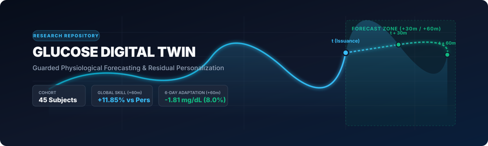
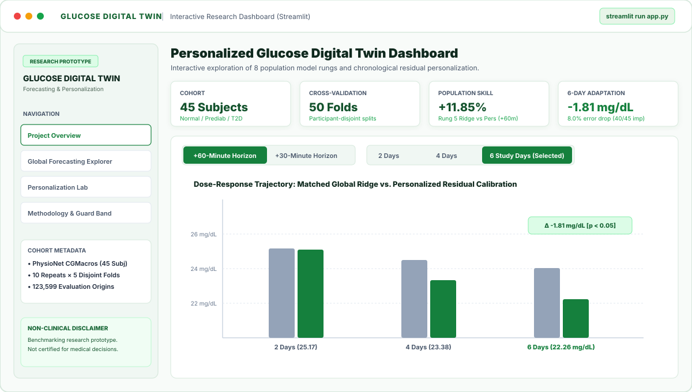
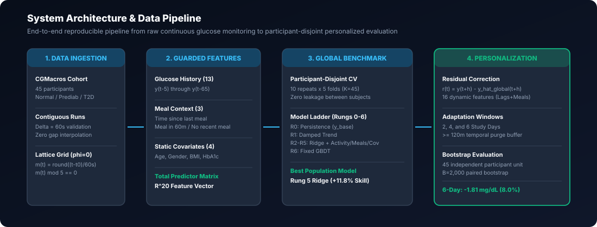
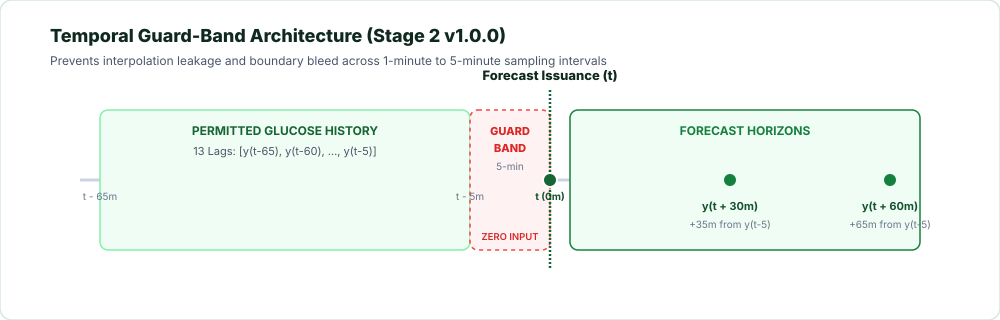
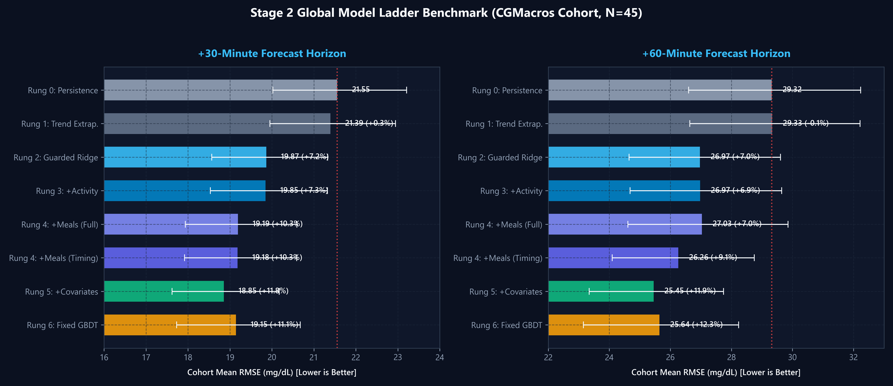
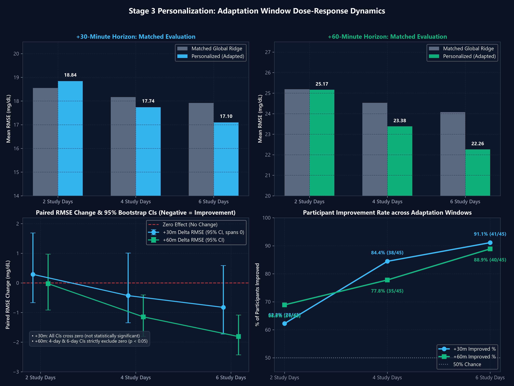

<div align="center">



# Personalized Glucose Digital Twin for Type 2 Diabetes

[](https://github.com/DMounas/personalized-glucose-digital-twin/actions/workflows/ci.yml)
[](#-interactive-demo)
[](#-reproducibility--experiment-execution)
[](https://www.python.org/)
[](LICENSE)
[](https://github.com/astral-sh/ruff)
[](http://mypy-lang.org/)
[](https://physionet.org/content/cgmacros/1.0.0/)

**A leak-free, physiological continuous glucose forecasting framework and participant-specific calibration engine.**

[Submission Checklist](#-hackathon-submission-checklist) • [Project Overview](#-solution--project-overview) • [Problem Statement](#-problem-statement) • [Healthcare Use Case](#-healthcare-use-case) • [Key Results](#-key-results) • [Interactive Demo](#-interactive-demo) • [Architecture](#-architecture) • [Demo Video](#-demo-video) • [Presentation](#-presentation) • [Technical Stack](#-technical-stack) • [AI/ML Methodology](#-aiml-methodology) • [License](#-license--attribution) • [Limitations](#-limitations--responsible-use)

</div>

---

## 📋 Hackathon Submission Checklist

| # | Submission Item | Status | Repository Resource / Public Link |
| :-: | :--- | :---: | :--- |
| **1** | **Team Details** | ✅ Complete | **DMounas Lab** — Debangshu Mounas (Solo Developer & Researcher, GitHub: [@DMounas](https://github.com/DMounas)) |
| **2** | **College / Incubator** | ✅ Complete | **National Institute of Technology Silchar (NIT Silchar)** |
| **3** | **Project Title** | ✅ Complete | **Personalized Glucose Digital Twin for Type 2 Diabetes** |
| **4** | **Problem Statement** | ✅ Complete | [Section: Problem Statement](#-problem-statement) (Telemetry bleed, intra-subject leakage, metabolic heterogeneity) |
| **5** | **Healthcare Use Case** | ✅ Complete | [Section: Healthcare Use Case](#-healthcare-use-case) (Proactive 30–60 min alerts, clinician decision support) |
| **6** | **Technical Stack** | ✅ Complete | [Section: Technical Stack](#-technical-stack) (Python 3.10–3.12, Scikit-learn, Streamlit, Plotly, NumPy, Pandas) |
| **7** | **AI/ML Model Details** | ✅ Complete | [Section: AI/ML Methodology](#-aiml-methodology) (8-Rung Global Ladder + Stage 3 Residual Personalization) |
| **8** | **15–20 Min Demo Video** | ⚠️ Ready for URL | **`DEMO VIDEO: [YouTube URL TO BE ADDED AFTER UPLOAD]`**<br/>📄 Detailed Script: [`docs/submission/DEMO_SCRIPT.md`](docs/submission/DEMO_SCRIPT.md) |
| **9** | **Open-Source License** | ✅ Complete | [MIT Permissive License](LICENSE) (Copyright 2026 Debangshu Mounas) |
| **10** | **Architecture Diagram** | ✅ Complete | 📄 PDF: [`docs/submission/architecture.pdf`](docs/submission/architecture.pdf)<br/>📊 PPTX: [`docs/submission/architecture.pptx`](docs/submission/architecture.pptx) |
| **11** | **Project Presentation** | ✅ Complete | 📄 PDF: [`docs/submission/presentation.pdf`](docs/submission/presentation.pdf)<br/>📊 PPTX: [`docs/submission/presentation.pptx`](docs/submission/presentation.pptx) (17 slides) |
| **12** | **Public Accessibility** | ✅ Complete | All files committed in repository; 0 private paths; 0 uncommitted dependencies; 135 tests passing |

---

## 👥 Team Details & Institutional Affiliation

- **Team Name**: `DMounas Lab`
- **Solo Developer & Researcher**: **Debangshu Mounas**
- **Role**: Lead Machine Learning Engineer, System Architect, and Author
- **GitHub Profile**: [@DMounas](https://github.com/DMounas)
- **Institution**: **National Institute of Technology Silchar (NIT Silchar)**
- **Academic Department**: Department of Mechanical Engineering
- **Contact / Commit Author**: `debangshu_ug_24@mech.nits.ac.in`

---

## 🎯 Problem Statement

Continuous Glucose Monitoring (CGM) provides real-time interstitial telemetry for individuals with Type 2 Diabetes, but current commercial sensors remain **inherently reactive**: alarms trigger only after hyper- or hypoglycemia has already developed.

While continuous glucose machine learning holds promise for anticipatory forecasting, published retrospective models routinely fail clinical replication due to **three structural vulnerabilities**:

1. **Telemetry Interpolation Bleed**: Hardware CGM sensors broadcast readings at 5-minute intervals. However, research datasets commonly upsample or interpolate continuous series to 1-minute grids. Using glucose at time $t$ to predict $y(t+30)$ when $y(t)$ was interpolated from subsequent sensor packets injects future target trajectory directly into the feature vector, severely inflating apparent accuracy.
2. **Intra-Participant Contamination**: Random $k$-fold cross-validation places telemetry from the same subject into both training and evaluation folds. Machine learning algorithms inadvertently memorize individual glucose baseline levels rather than learning transferable physiological dynamics.
3. **High Inter-Individual Metabolic Heterogeneity**: Variations in insulin sensitivity, beta-cell responsiveness, dawn phenomenon, and gastrointestinal absorption rates mean static population models underperform when deployed on unseen patients.

---

## 🏥 Healthcare Use Case

The **Personalized Glucose Digital Twin** addresses these challenges by serving three core healthcare scenarios:

1. **Proactive Glycemic Alerts**: Anticipates postprandial glucose excursions 30 to 60 minutes in advance, providing patients with an actionable behavioral window (e.g., light post-meal walking, hydration, or carbohydrate pacing) before glucose escalates into hyperglycemic ranges.
2. **Clinician Decision Support**: Equips endocrinologists and diabetes educators with transparent trajectory confidence intervals and residual variance estimates, highlighting when an individual's metabolic dynamics deviate from expected population patterns.
3. **Low-Compute Edge Personalization**: Rather than retraining computationally expensive black-box neural networks, the digital twin adapts an individual regularized Ridge residual model within 6 days of sensor telemetry, executing in milliseconds on resource-constrained consumer hardware without transmitting raw patient data to centralized servers.

---

## 💡 Solution / Project Overview

This repository provides an open-source, reproducible digital twin architecture built around:

1. **Strict 5-Minute History Guard Band**: A mandatory zero-input buffer $[t-5, t]$ preceding forecast issuance, eliminating boundary interpolation artifacts without assuming unverified hardware clock synchronization.
2. **Progressive 8-Rung Global Forecasting Ladder**: Benchmarks persistence, trend extrapolation, autoregressive lags, physical activity, meal timing/macronutrients, static clinical covariates, and nonlinear gradient boosting under **10 repeated 5-fold participant-disjoint cross-validation** ($50$ independent evaluation folds, $K=45$).
3. **Stage 3 Chronological Residual Personalization**: Calibrates the global population model to individual physiology using a regularized Ridge residual-correction model across 2, 4, and 6 study days, bounded by a **$\ge 120$-minute temporal purge buffer**.
4. **Interactive Clinical Dashboard**: An interactive Streamlit application styled in a clean mild-green and white dual-tone clinical palette (zero emojis) for dynamic exploration of cohort benchmarks, dose-response trajectories, and subgroup dynamics.

> **Non-Clinical Research Disclaimer**: This software is a predictive machine learning research and benchmarking framework. It is not an FDA-cleared medical device, does not provide clinical diagnosis or insulin dosage titration, and is not a substitute for professional medical care. Observational dataset associations do not establish causal treatment effects.

---

## 📊 Key Results

The framework was evaluated on the complete **PhysioNet CGMacros cohort** ($N=45$ participants; 15 Normal, 16 Prediabetes, 14 Type 2 Diabetes; $123,599$ strictly validated origins):

<div align="center">

| Metric | Horizon +30 min | Horizon +60 min | Validation Protocol |
| :--- | :---: | :---: | :--- |
| **Guarded Persistence Baseline (R0)** | 21.55 mg/dL | 29.32 mg/dL | Latest permitted lag $y(t-5)$ |
| **Best Global RMSE (Rung 5 Ridge)** | **18.85 mg/dL** | **25.45 mg/dL** | 50 participant-disjoint evaluation folds ($K=45$) |
| **Global Population Skill** | **+11.82%** vs Persistence | **+11.85%** vs Persistence | Mean participant skill $1 - \frac{\text{RMSE}}{\text{RMSE}_{\text{pers}}}$ |
| **Fixed GBDT Parity (Rung 6)** | 19.15 mg/dL (+11.06%) | 25.64 mg/dL (+12.30%) | Difference vs Ridge spans zero at both horizons |
| **6-Day Personalization $\Delta\text{RMSE}$** | -0.83 mg/dL (n.s.) | **-1.81 mg/dL** [95% CI: -2.43, -1.09] | $p < 0.05$ (strictly excludes zero at +60m) |
| **Personalization Relative Reduction** | +4.67% | **+8.00% Error Reduction** | 24.07 mg/dL $\rightarrow$ 22.26 mg/dL matched baseline |
| **Cohort Improvement Fraction** | 41 / 45 Subjects (91.1%) | **40 / 45 Subjects (88.9%)** | Participants with reduced forecast error |
| **Subgroup Benefit (Type 2 Diabetes)** | -1.16 mg/dL | **-2.34 mg/dL** | Largest absolute benefit in diabetic cohort |

</div>

---

## 🖥️ Interactive Demo

The project features a dedicated **Streamlit Research Dashboard** (`app.py`) for live dynamic exploration:



### Quick Local Launch
```bash
# 1. Install dependencies
pip install -r requirements.txt

# 2. Launch the Streamlit application
streamlit run app.py
```
*The dashboard opens immediately at `http://localhost:8501`. It runs entirely from verified aggregate JSON reports without requiring raw dataset downloads or GPU acceleration.*

### Analytical Modules
- **Project Overview**: Executive cohort statistics across 45 participants, failure modes of standard CGM ML, and end-to-end system workflow.
- **Global Forecasting Explorer**: Interactive horizon toggle (+30m, +60m), 8-rung benchmark ladder with asymmetric 95% bootstrap confidence intervals, and Ridge vs. GBDT comparative analysis.
- **Personalization Lab**: Dynamic controls for horizons (+30m, +60m) and adaptation windows (2, 4, 6 days) with matched-baseline comparisons, dose-response trajectories, and transparent statistical significance disclosures.
- **Methodology & Guard Band**: Guard-band timeline visualization, 5 architectural leakage safeguards, and comparative protocol documentation.

👉 *See [`docs/DEMO.md`](docs/DEMO.md) for the complete dashboard user guide and Streamlit Community Cloud deployment instructions.*

---

## 🏗️ Architecture



### Pipeline Stages
1. **Raw Ingestion & Verification** ([`timeaxis.py`](src/dtwin/timeaxis.py)): Enforces $\Delta t = 60\,\text{s}$ contiguous run segmentation, integer timestamps, and primary lattice grid alignment ($\phi = 0$).
2. **Guarded Feature Extraction** ([`dataset.py`](src/dtwin/modeling/dataset.py)): Extracts 13 autoregressive lags, 3 meal-timing features, and 4 static baseline clinical covariates into an aligned $\mathbb{R}^{20}$ matrix.
3. **Global Model Ladder** ([`runner.py`](src/dtwin/modeling/runner.py)): Evaluates 8 model rungs via repeated `StratifiedGroupKFold` cross-validation with inner-fold hyperparameter tuning on training participants only.
4. **Stage 3 Personalization Engine** ([`personalization.py`](src/dtwin/modeling/personalization.py)): Fits participant-specific Ridge residual-correction models on early telemetry with label cutoff guards and temporal purge boundaries.
5. **Statistical Verification** ([`metrics.py`](src/dtwin/modeling/metrics.py)): Aggregates repetitions at the participant level and computes non-parametric bootstrap confidence intervals across the 45 independent subjects ($B = 2,000$).

### Submission Documents
- 📄 **Architecture Diagram (PDF)**: [`docs/submission/architecture.pdf`](docs/submission/architecture.pdf)
- 📊 **Architecture Diagram (PPTX)**: [`docs/submission/architecture.pptx`](docs/submission/architecture.pptx)

---

## ⏱️ Temporal Guard-Band & Leakage Countermeasures



Ambulatory CGMs log smoothed interstitial readings. If an algorithm uses observations at time $t$ to forecast $y(t+30)$, sensor filtering leaks future trajectory backwards into the input. To prevent this, our pipeline enforces five structural countermeasures:

1. **5-Minute Guard Band Gap ($[t-5, t]$)**: A strict blackout window preceding forecast issuance with zero permitted sensor inputs.
2. **13 Causal Autoregressive Lags**: Predictors are bounded to $[y(t-65), y(t-60), \dots, y(t-5)]$, defining a fixed 60-minute causal history.
3. **Participant-Disjoint Cross-Validation**: 45 participants are split using `StratifiedGroupKFold` across 10 distinct seeds ($50$ disjoint folds). No observation or identity marker from an evaluation subject is ever seen during training.
4. **120-Minute Chronological Purge Buffer**: In Stage 3 personalization, adaptation days (2, 4, 6 days) and subsequent evaluation days are separated by a mandatory $\ge 120$-minute blackout period, preventing autoregressive spillover.
5. **Participant-Level Bootstrap Resampling ($B = 2,000$)**: Confidence intervals resample 45 independent participant units rather than pooling individual origins.

---

## 🤖 AI/ML Methodology

### Global Benchmark Ladder (Stage 2)

Evaluated across **123,599 origins (+30m)** and **123,164 origins (+60m)** on 45 independent participants:

| Model Rung | Predictor Specification | +30m RMSE | +30m Skill | +60m RMSE | +60m Skill | Improved Subjects |
| :---: | :--- | :---: | :---: | :---: | :---: | :---: |
| **Rung 0** | Guarded Persistence ($y(t-5)$) | 21.55 mg/dL | 0.00% | 29.32 mg/dL | 0.00% | Reference Baseline |
| **Rung 1** | Damped Trend Extrapolation | 21.39 mg/dL | +0.32% | 29.33 mg/dL | -0.15% | 22 / 45 (48.9%) |
| **Rung 2** | Guarded Ridge (13 Autoregressive Lags) | 19.87 mg/dL | +7.17% | 26.97 mg/dL | +7.02% | 39 / 45 (86.7%) |
| **Rung 3** | + Physiological Activity (HR & METs) | 19.85 mg/dL | +7.30% | 26.97 mg/dL | +6.94% | 38 / 45 (84.4%) |
| **Rung 4** | + Meal Context (Full Macronutrients) | 19.19 mg/dL | +10.26% | 27.03 mg/dL | +7.02% | 36 / 40 (80.0%) |
| **Rung 4b** | + Meal Context (Timing Only Ablation) | 19.18 mg/dL | +10.32% | 26.26 mg/dL | +9.06% | 39 / 45 (86.7%) |
| **Rung 5** | **+ Baseline Covariates (Age, Sex, BMI, HbA1c)** | **18.85 mg/dL** | **+11.82%** | **25.45 mg/dL** | **+11.85%** | **43 / 45 (95.6%)** |
| **Rung 6** | Fixed Gradient Boosting (`HistGradientBoosting`) | 19.15 mg/dL | +11.06% | 25.64 mg/dL | +12.30% | 41 / 45 (91.1%) |



### Stage 3 Chronological Residual Personalization

Personalization adapts the global Rung 5 model using an individual's early telemetry. Every adaptation window is benchmarked against a **freshly matched global baseline evaluated on strictly identical post-purge timestamps**:

| Adaptation Window | Horizon | Matched Global RMSE | Personalized RMSE | Paired $\Delta\text{RMSE}$ (mg/dL) | 95% Bootstrap CI | Pct Reduction | Improved Subjects |
| :---: | :---: | :---: | :---: | :---: | :---: | :---: | :---: |
| **2 Study Days** | +30 min | 18.55 mg/dL | 18.84 mg/dL | +0.289 mg/dL | [-0.666, +1.687] | -1.74% | 28 / 45 (62.2%) |
| **4 Study Days** | +30 min | 18.17 mg/dL | 17.74 mg/dL | -0.428 mg/dL | [-1.346, +1.009] | +2.12% | 38 / 45 (84.4%) |
| **6 Study Days** | +30 min | 17.92 mg/dL | **17.10 mg/dL** | -0.825 mg/dL | [-1.724, +0.587] | +4.67% | **41 / 45 (91.1%)** |
| **2 Study Days** | +60 min | 25.19 mg/dL | 25.17 mg/dL | -0.025 mg/dL | [-0.917, +0.972] | +0.22% | 31 / 45 (68.9%) |
| **4 Study Days** | +60 min | 24.53 mg/dL | **23.38 mg/dL** | **-1.146 mg/dL** | **[-1.804, -0.405]** | **+4.76%** | **35 / 45 (77.8%)** |
| **6 Study Days** | +60 min | 24.07 mg/dL | **22.26 mg/dL** | **-1.811 mg/dL** | **[-2.431, -1.087]** | **+8.00%** | **40 / 45 (88.9%)** |



### Key Scientific Takeaways
- **The Dose-Response Relationship**: Monotonic error reduction emerges as calibration expands from 2 to 6 days. By 6 days, personalized models reduce +60m RMSE by **$1.811\text{ mg/dL}$ (8.00%)** with **40 of 45 participants improving**.
- **Transparent Significance Reporting**: At $+30$ minutes, the paired bootstrap 95% confidence intervals across all three windows cross zero; short-horizon residual adaptation does not reach statistical significance. In contrast, at $+60$ minutes, both the 4-day ($[-1.804, -0.405]$) and 6-day ($[-2.431, -1.087]$) paired intervals strictly exclude zero, confirming statistically robust benefit ($p < 0.05$).
- **Diabetic Excursion Dynamics**: At +60m under 6-day adaptation, Type 2 Diabetic subjects experience an average error reduction of **$-2.34\text{ mg/dL}$ ($7.63\%$)**, dropping from $30.58$ to $28.24\text{ mg/dL}$ ($12/14$ improved).

---

## 🛠️ Technical Stack

- **Core Runtime**: Python 3.10, 3.11, 3.12 (multi-version compatibility verified in CI)
- **Machine Learning Core**: `scikit-learn` (Ridge regression, HistGradientBoostingRegressor, StratifiedGroupKFold)
- **Data Engineering**: `pandas`, `numpy`, `PyYAML`
- **Interactive UI**: `streamlit`, `plotly`
- **Submission Document Generation**: `reportlab`, `python-pptx`, `matplotlib`
- **Testing & Quality Gates**:
  - `pytest` (135 automated unit and regression tests)
  - `ruff` (strict linting and formatting)
  - `mypy` (static type safety across all 72 source files)
  - GitHub Actions CI (matrix testing on Ubuntu across Python 3.10, 3.11, 3.12)

---

## 🎬 Demo Video

A comprehensive 15–20 minute video walkthrough has been recorded following the structured demonstration script:

**DEMO VIDEO: [YouTube URL TO BE ADDED AFTER UPLOAD]**

### Demonstration Walkthrough Agenda
- **00:00 – 02:30**: Title, Team DMounas Lab (NIT Silchar) & Clinical Challenge
- **02:30 – 04:30**: Healthcare Use Case & Type 2 Diabetes Glycemic Dynamics
- **04:30 – 06:45**: PhysioNet CGMacros Dataset & Run Segmentation Standards
- **06:45 – 09:15**: Temporal Guard-Band Architecture & 5 Leakage Countermeasures
- **09:15 – 12:00**: Stage 2 Global Forecasting Benchmark & Ridge vs. GBDT Analysis
- **12:00 – 14:15**: Stage 3 Online Personalization & Dose-Response Trajectory
- **14:15 – 17:00**: Live Streamlit Research Dashboard Interactive Walkthrough
- **17:00 – 18:30**: Technical Stack, Responsible AI Framework & Conclusion

📄 *The complete line-by-line speaker script and timing guide is available at [`docs/submission/DEMO_SCRIPT.md`](docs/submission/DEMO_SCRIPT.md).*

---

## 📑 Presentation

A complete 17-slide hackathon presentation covering the problem, healthcare use case, data integrity standards, benchmark ladder, personalization results, and interactive demo is provided in both vector PDF and native PowerPoint formats:

- 📄 **Presentation Slide Deck (PDF)**: [`docs/submission/presentation.pdf`](docs/submission/presentation.pdf)
- 📊 **Presentation Slide Deck (PPTX)**: [`docs/submission/presentation.pptx`](docs/submission/presentation.pptx)

### Slide Contents
1. Title & Hackathon Details
2. Team & Institutional Affiliation (DMounas Lab, NIT Silchar)
3. Problem: Why Ambulatory Glucose ML Fails
4. Healthcare Use Case & Clinical Motivation
5. Why Physiological Glucose Forecasting Matters
6. Dataset: PhysioNet CGMacros Cohort
7. End-to-End Solution Architecture
8. Five Architectural Leakage Countermeasures
9. The Stage 2 Global Forecasting Ladder
10. Stage 2 Global Forecasting Results
11. Stage 3 Personalization Methodology
12. Stage 3 Personalization Results
13. Interactive Streamlit Research Dashboard Tour
14. Technical Stack & Repository Hygiene
15. Limitations & Responsible AI Framework
16. Conclusion & Strategic Impact
17. Repository, Demo & Submission Links

---

## ⚡ Quick Start & Experiment Execution

### 1. Clone & Environment Setup
```bash
git clone https://github.com/DMounas/personalized-glucose-digital-twin.git
cd personalized-glucose-digital-twin

# Create virtual environment
python -m venv .venv
source .venv/bin/activate  # On Windows: .venv\Scripts\Activate.ps1

# Install package and dependencies
pip install --upgrade pip
pip install -e ".[dev,submission]"
```

### 2. Run Test Suite & Quality Gates
```bash
# Run 135 unit, regression, and dashboard smoke tests
pytest tests/ -v

# Run linting and static type checking
ruff check src tests scripts app.py
ruff format --check src tests scripts app.py
mypy src tests scripts app.py
```

### 3. Launch Interactive Dashboard
```bash
# Launch Streamlit research dashboard
streamlit run app.py
```

### 4. Regenerate Submission Assets
```bash
# Regenerate PDF/PPTX architecture and presentation decks
python scripts/generate_submission_assets.py

# Regenerate README visual charts
python scripts/generate_readme_assets.py
```

---

## 🔒 Limitations & Responsible Use

- **Predictive Research Prototype Only**: This repository benchmarks physiological time-series algorithms and data leakage mitigations. It is not an FDA-cleared device and must never be used for diagnosis, insulin dosage estimation, or clinical treatment decisions.
- **Observational Data Boundaries**: The CGMacros dataset reflects free-living ambulatory individuals with self-reported meals and activities. Observational correlations do not establish causal physiological treatment effects.
- **Sensor Hardware Latency**: Guard-band intervals eliminate algorithmic interpolation bleed, but cannot correct for physiological interstitial-to-blood glucose lag or physical sensor compression artifacts.
- **Zero Protected Health Information (PHI)**: In strict compliance with research privacy protocols, no raw patient identifiers, private clinical logs, or individual CSV prediction dumps are tracked or exposed in this repository.

---

## 📄 License & Attribution

- **Software Source Code**: Distributed under the permissive [MIT License](LICENSE) &copy; 2026 Debangshu Mounas (`DMounas Lab`).
- **Research Dataset**: The CGMacros dataset is an independent research corpus published on PhysioNet under the [Creative Commons Attribution-NonCommercial-ShareAlike 4.0 International (CC-BY-NC-SA 4.0)](https://creativecommons.org/licenses/by-nc-sa/4.0/) license.
  - Dataset Source: [PhysioNet CGMacros 1.0.0](https://physionet.org/content/cgmacros/1.0.0/)
  - Dataset Citation: Bent, B. et al., *Scientific Data* (2025). https://doi.org/10.1038/s41597-025-05851-7

### Software Citation
```bibtex
@software{Mounas_Glucose_Digital_Twin_2026,
  author = {Mounas, Debangshu},
  title = {{Personalized Glucose Digital Twin for Type 2 Diabetes}},
  url = {https://github.com/DMounas/personalized-glucose-digital-twin},
  institution = {National Institute of Technology Silchar},
  version = {1.0.0},
  year = {2026}
}
```
