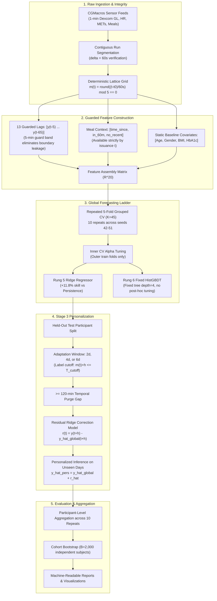

# System Architecture & Technical Design

## 1. Architectural Overview

The **Personalized Glucose Digital Twin** is designed as a modular, highly decoupled research engineering framework for continuous physiological time-series forecasting and downstream individual calibration.

---

## 2. Module Responsibilities

| Python Module | Package Path | Primary Responsibility |
| :--- | :--- | :--- |
| [`timeaxis.py`](../src/dtwin/timeaxis.py) | `dtwin.timeaxis` | Contiguous run segmentation, integer delta verification, deterministic minute elapsed time $m(t)$. |
| [`dataset.py`](../src/dtwin/modeling/dataset.py) | `dtwin.modeling.dataset` | Guard-band origin extraction, lag assembly, meal and activity alignment under $\phi = 0$. |
| [`baselines.py`](../src/dtwin/modeling/baselines.py) | `dtwin.modeling.baselines` | Rung 0 (Guarded Persistence) and Rung 1 (Damped Trend Extrapolation with $\gamma$ tuning). |
| [`ridge.py`](../src/dtwin/modeling/ridge.py) | `dtwin.modeling.ridge` | Rung 2 Guarded Ridge regression on 13 lags with inner participant-grouped CV. |
| [`activity.py`](../src/dtwin/modeling/activity.py) | `dtwin.modeling.activity` | Rung 3 Heart rate and METs rolling summary extraction and training-fold imputation. |
| [`meal.py`](../src/dtwin/modeling/meal.py) | `dtwin.modeling.meal` | Rung 4 Macronutrient and timing feature extraction, `MealPreprocessor` fit/transform. |
| [`covariates.py`](../src/dtwin/modeling/covariates.py) | `dtwin.modeling.covariates` | Rung 5 Static biological covariate loading, median/mode imputation, and feature matrix assembly. |
| [`boosting.py`](../src/dtwin/modeling/boosting.py) | `dtwin.modeling.boosting` | Rung 6 Native `HistGradientBoostingRegressor` with fixed prespecified hyperparameters. |
| [`personalization.py`](../src/dtwin/modeling/personalization.py) | `dtwin.modeling.personalization` | Stage 3 adaptation partitioning, label cutoff validation, residual-correction Ridge model. |
| [`personalization_runner.py`](../src/dtwin/modeling/personalization_runner.py) | `dtwin.modeling.personalization_runner` | End-to-end execution of Stage 3 across 2, 4, 6 study days and both horizons. |
| [`metrics.py`](../src/dtwin/modeling/metrics.py) | `dtwin.modeling.metrics` | Participant-level aggregation, skill scoring, paired differences, and 45-participant bootstrap CIs. |
| [`cv.py`](../src/dtwin/modeling/cv.py) | `dtwin.modeling.cv` | 10-repeat 5-fold stratified participant-disjoint partition generator (`StratifiedGroupKFold`). |

---

## 3. Data Leakage Countermeasures

1. **Intra-Participant Partitioning Isolation**: All cross-validation partitioning groups strictly by `participant_id`. Zero recordings from an evaluation participant are present in the training set during global model fitting.
2. **Deterministic Grid Isolation ($\phi = 0$)**: The forecasting lattice is fixed at a single deterministic grid phase $m(t) \pmod 5 = 0$, derived exclusively from the recording anchor $t_0$.
3. **Temporal Guard Band**: All glucose feature lags use $[t-65, \dots, t-5]$. The latest glucose input is strictly 5 minutes prior to forecast issuance $t$, eliminating interpolation contamination from sensor smoothing.
4. **Personalization Purge & Label Boundary**:
   - Adaptation samples must satisfy $m(t) + h \le T_{\text{cutoff}}$ (observed target label cannot cross the cutoff).
   - Minimum 120-minute purge buffer enforced immediately after $T_{\text{cutoff}}$.
   - Earliest evaluation history observation occurs at least 55 minutes after the latest adaptation target observation.
