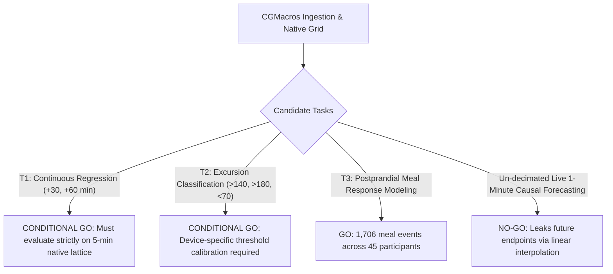

# Digital Twin Modeling Specification & Predictive Readiness

**Status**: SPECIFICATION APPROVED FOR STAGE 2  
**Dataset**: CGMacros v1.0.0 ($N = 45$ study completers, $687,580$ 1-minute rows)  
**Configuration**: `configs/stage1b.yaml` (Hash: `8de86ba3edc17f21769f59dd608300f88c283a06f23beba46f90718132dbcdb3`)  
**Auditor**: Implementation Engineer (Antigravity)

---

## 1. Candidate Forecasting Tasks & Feasibility Decisions

### Task Assessment Matrix

| Task ID | Task Description | Horizon | Target Signal | Evaluation Status | Empirical Feasibility & Decision |
|:---|:---|:---:|:---:|:---:|:---|
| **T1** | **Short-Term Glucose Forecasting** | +30, +60 min | Dexcom G6 Pro (mg/dL) | **CONDITIONAL GO** | Feasible only when evaluated on decimated 5-minute native points. 30-min median $|\Delta| = 7.6\text{ mg/dL}$, 60-min median $|\Delta| = 11.0\text{ mg/dL}$. |
| **T2** | **Excursion Episode Prediction** | +30, +60 min | Hyper/Hypo flags | **CONDITIONAL GO** | Feasible, but episode prevalence is highly device-dependent (Dexcom detects $1,228$ hyperglycemia episodes $>140$ vs Libre $779$; Libre detects $498$ hypoglycemia episodes $<70$ vs Dexcom $41$). Model must be calibrated to sensor target. |
| **T3** | **Postprandial Meal Response** | +120, +180 min | Postprandial peak / iAUC | **GO** | $1,706$ discrete meal events across $45$ participants ($1,363$ main meals, $343$ snacks). Serves as established primary baseline in literature. |
| **T4** | **Live 1-Minute Causal Forecasting** | Any | Interpolated 1-min grid | **NO-GO** | Prohibited. Intervening points linearly depend on future native measurements ($t_{future}$). Cannot represent live streaming telemetry without future leakage. |

---

## 2. Primary Device Selection Rule

The primary predictive sensor is selected based on a **hierarchical composite rule** defined prior to sensor analysis:

1. **Native Information Density**: Dexcom G6 Pro samples natively at **5-minute intervals** ($288\text{ points/day}$), providing $3\times$ higher temporal resolution than Abbott FreeStyle Libre Pro ($15\text{ minutes}$, $96\text{ points/day}$).
2. **Phase Lag & Latency**: Empirical cross-correlation demonstrates that FreeStyle Libre Pro lags Dexcom G6 Pro by **$3 - 5\text{ minutes}$** due to 15-minute moving/linear interpolation filtering. Dexcom offers a cleaner, lower-latency causal target.
3. **Primary Recommendation**: **Dexcom G6 Pro** is designated as the primary forecast target for Stage 2.
4. **Mandatory Sensitivity Analysis**: Every model architecture trained on Dexcom must undergo a paired sensitivity analysis re-evaluated on FreeStyle Libre Pro to quantify generalizability across sensor hardware.

---

## 3. Comprehensive Prediction-Time Feature Availability Register

To guarantee leakage-safe validation, every feature is assigned an explicit availability timestamp relative to forecast origin $T$:

| Feature Name | Source | Sampling | Availability at Origin $T$ | Permitted for Task | Leakage Hazard & Mitigation |
|:---|:---|:---:|:---:|:---:|:---|
| `dexcom_gl` | Timeseries | 5-min native | Known strictly for $t \le T$ | T1, T2, T3 | **FL-01**: Future points ($t > T$) must not be used in filtering or causal features. |
| `libre_gl` | Timeseries | 15-min native | Known strictly for $t \le T$ | T1, T2, T3 | **FL-01**: Must not be used if native sampling point falls after $T$. |
| `heart_rate` | Fitbit Sense | 1-min | Known strictly for $t \le T$ | T1, T2, T3 | Historical moving averages over $[T-60, T]$ permitted. |
| `mets` | Fitbit Sense | 1-min | Known strictly for $t \le T$ | T1, T2, T3 | Scaled by $0.1$. Available in 34/45 participants; imputation flag required. |
| `meal_type` | Dietary Log | Impulse | Known at meal start $T_{\text{meal}}$ | T1, T2, T3 | Impulse encoding at $T_{\text{meal}}$. |
| `meal_carbs`, `meal_calories`, `meal_protein`, `meal_fat` | Dietary Log | Impulse | Known at meal start $T_{\text{meal}}$ | T1, T2, T3 | Assumes pre-meal logging or what-if scenario specification. |
| `fiber` | Dietary Log | Impulse | Known at meal start $T_{\text{meal}}$ | T1, T2, T3 | Values $> 100\text{ g}$ flagged with `fiber_unit_anomaly_flag` and winsorized. |
| `amount_consumed` | Dietary Log | Static | **PROHIBITED** at $T_{\text{meal}}$ | **NONE** | Recorded post-meal; leaks meal completion. |
| `baseline_age`, `gender`, `bmi` | `bio.csv` | Baseline | Known for all $t$ | T1, T2, T3 | Static participant covariates. |
| `baseline_hba1c` | `bio.csv` | Baseline | Known for all $t$ | T1, T2, T3 | NGSP percentage (4.6% - 8.5%). |
| `fingerstick_glu_*` | `bio.csv` | Baseline | **PROHIBITED** | **NONE** | **FL-02**: Clinical visit spot-checks lacking reliable date alignment. Excluded. |
| `microbes` (1,979 taxa) | `microbes.csv` | Microbiome | **PROHIBITED** | **NONE** | Excluded due to severe $P \gg N$ overfitting risk ($N=45$ vs $1,979$ taxa). |
| `gut_health` (22 pathways) | `gut_health_test.csv` | Viome scores | Optional static | Exploratory | Ordinal scores (1, 2, 3). Available for 45 completers. |

---

## 4. Time Series Segmentation & Gap Handling

1. **Session Boundary Rule**: Any gap between consecutive timestamps exceeding **30 minutes** demarcates a session boundary.
2. **Autoregressive Isolation**: Autoregressive lag features (e.g., $y_{T-15}, y_{T-30}$) must **never cross session boundaries**. If a 60-minute historical window crosses an unrecorded gap, that window is invalid and must be discarded.
3. **Multi-Session Handling**: Participants with disjoint sessions (e.g., 16 sessions across 19 days) must be processed as independent continuous sub-series.
4. **Censored Values**: Sensor readings at hardware saturation limits ($< 40\text{ mg/dL}$ or $> 400\text{ mg/dL}$) must be explicitly flagged and evaluated with Tobit loss or interval censoring.

---

## 5. Leakage-Safe Cross-Validation Design

1. **Grouped Splitting**: Models must be evaluated using **Participant-Grouped $K$-Fold Cross-Validation** ($K = 5$) or **Leave-One-Participant-Out (LOPO)**.
2. **Strict Cohort Separation**: All observations from a given participant must belong exclusively to either the training set or the test set.
3. **Zero Random Splitting**: Random shuffling of time-series rows or overlapping windows is strictly forbidden.
4. **Causal Preprocessing**: Feature scalers, imputers, and normalization parameters must be fitted solely on the training folds and applied out-of-fold to validation participants.

---

## 6. Evaluation Metrics & Statistical Reporting

For continuous forecasting (Task T1):
- **Root Mean Squared Error (RMSE)**: Evaluated at participant level.
- **Mean Absolute Error (MAE)**: Evaluated at participant level.
- **Mean Absolute Relative Difference (MARD)**: Relative to target CGM sensor.
- **Participant-Clustered Bootstrap**: All metric reports must include 95% confidence intervals derived from participant-clustered bootstrap ($B = 1,000$ iterations).
