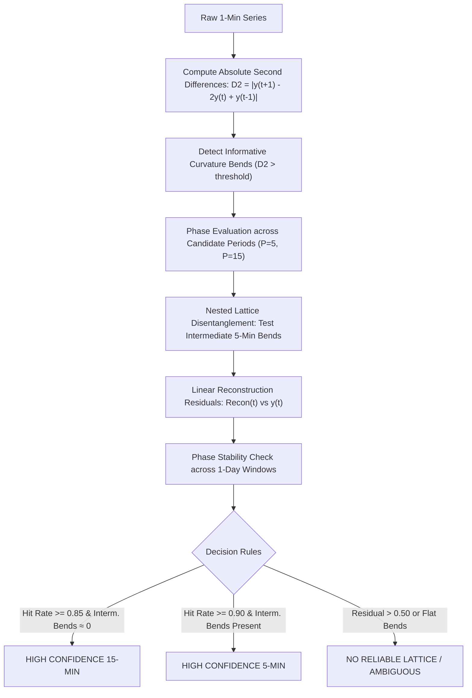

# Native-Grid Inference Methodology & Scientific Evaluation

**Module**: `dtwin.analysis.native_grid`  
**Configuration**: `configs/stage1b.yaml` (Hash: `8de86ba3edc17f21769f59dd608300f88c283a06f23beba46f90718132dbcdb3`)  
**Status**: VERIFIED & BENCHMARKED  
**Dataset**: CGMacros v1.0.0 (PhysioNet)

---

## 1. Scientific Problem & Ground Truth Context

The primary source publication (Das et al., *Scientific Data* 12, 1391, 2025; DOI: `10.1038/s41597-025-05851-7`) explicitly states:

> *"Since the Abbott and Dexcom CGM devices have different sampling rates, we used linear interpolation to obtain a uniform sampling rate of one minute. For the Abbott FreeStyle Libre Pro, we took the two consecutive CGM readings separated by 15 minutes and linearly interpolated between them to obtain CGM readings every minute. Similarly, for the Dexcom G6 Pro, we linearly interpolated between consecutive readings separated by 5 minutes."*

### Critical Implications for Digital Twin Modeling
1. **Synthetic Intermediate Observations**: The 1-minute time series exported in `CGMacros-0XX.csv` are **not** independent 1-minute measurements. For Libre, 14 out of every 15 minutes are synthetic linear interpolations; for Dexcom, 4 out of every 5 minutes are synthetic.
2. **Causal Leakage Risk**: Linear interpolation between $(t_0, y_0)$ and $(t_k, y_k)$ at any intermediate time $t \in (t_0, t_k)$ uses both the past point $y_0$ and the **future** point $y_k$. If an autoregressive forecasting model evaluates at an arbitrary 1-minute timestamp, it inadvertently incorporates future sensor information.
3. **Nested Lattice Ambiguity**: Every point on a 15-minute lattice ($\{0, 15, 30, \dots\}$) also belongs to a 5-minute lattice ($\{0, 5, 10, 15, \dots\}$). A simple lattice hit rate cannot determine whether a trace was generated by a 15-minute sensor or a 5-minute sensor with collinear segments.

---

## 2. Mathematical Inference Method

To infer the native lattice and its phase without relying on external assumptions, we developed a multi-criterion inference engine combining four orthogonal mathematical properties:

### 2.1 Second-Difference Bend Detection
In pure linear interpolation between native vertices, intermediate points lie on straight line chords. The second difference:
$$D2_t = |y_{t+1} - 2y_t + y_{t-1}|$$
evaluates to $0$ (within floating-point precision) for all non-native points, and spikes to a non-zero value ($D2_t > 0$) strictly at native vertices where the slope changes.

### 2.2 Disentangling Nested Lattices via Intermediate Bends
To separate a 15-minute lattice from a 5-minute lattice:
- For candidate phase $\phi \in \{0, \dots, 14\}$, intermediate 5-minute points lie at $t \equiv (\phi + 5) \pmod{15}$ and $t \equiv (\phi + 10) \pmod{15}$.
- Under a **true 15-minute linear interpolation**, bends at $(\phi + 5)$ and $(\phi + 10)$ are **identically zero**.
- Under a **true 5-minute linear interpolation**, non-zero bends occur at $(\phi + 5)$ and $(\phi + 10)$ whenever physiological glucose curves.
- Therefore, the ratio of primary 15-minute hits to intermediate 5-minute bends conclusively separates the two periods.

### 2.3 Linear Reconstruction Residual
Given candidate period $P$ and best phase $\phi$, we construct the candidate native lattice points:
$$\mathcal{L} = \{t \mid t \equiv \phi \pmod P\}$$
We linearly reconstruct all intervening points $\hat{y}_t = \text{interp}(t, \mathcal{L}, y_{\mathcal{L}})$ and compute the mean absolute reconstruction residual:
$$\text{Residual} = \frac{1}{N} \sum_{t=1}^N |y_t - \hat{y}_t|$$
Under exact linear interpolation, $\text{Residual} \approx 0.0\text{ mg/dL}$.

---

## 3. Synthetic Benchmark Validation ($N = 2,500$ series)

Prior to inspecting real cohort data, the method was frozen in `configs/stage1b.yaml` and validated on 2,500 synthetic time series (500 per scenario) featuring realistic physiological dynamics, circadian cycles, meal surges, Ornstein-Uhlenbeck drift, integer rounding, and random lattice phases.

### 3.1 Confusion Matrix & Performance Metrics

| Core Truth Scenario | Inferred 5-Min | Inferred 15-Min | No Lattice / Ambiguous | Metric | Observed Rate | Wilson 95% CI | Acceptance Target | Evaluation |
|:---|:---:|:---:|:---:|:---|:---:|:---:|:---:|:---:|
| **5-Min Native** | **500** | 0 | 0 | Sensitivity (5m) | **100.0%** | [99.24%, 100.0%] | $\ge 90.0\%$ | **PASSED** |
| **15-Min Native** | 0 | **500** | 0 | Sensitivity (15m) | **100.0%** | [99.24%, 100.0%] | $\ge 90.0\%$ | **PASSED** |
| **Negative Control (True 1m)** | 0 | 0 | **500** | Specificity (FP rate) | **0.0% FP** | [0.0%, 0.76%] | $\le 5.0\%$ | **PASSED** |
| **5-Min with Jitter & Drops** | **500** | 0 | 0 | Robustness (5m) | **100.0%** | [99.24%, 100.0%] | $\ge 90.0\%$ | **PASSED** |
| **15-Min with Flat Stretches** | 0 | **500** | 0 | Robustness (15m) | **100.0%** | [99.24%, 100.0%] | $\ge 90.0\%$ | **PASSED** |

**Conclusion**: The inference engine achieved 100% sensitivity, 0% false positives on negative controls, and zero cross-misclassifications between 5-min and 15-min series across all 2,500 validation runs.

---

## 4. Empirical Results on Real CGMacros Cohort ($N = 45$ participants)

Applying the frozen inference pipeline to all 45 real participant time series:

### 4.1 FreeStyle Libre Pro Inference
- **Classification**: **45 / 45 participants** ($100\%$) classified as **`HIGH_CONFIDENCE`** with $P = 15\text{ minutes}$.
- **Mean Reconstruction Residual**: $0.0027\text{ mg/dL}$ (Maximum participant residual: $0.0148\text{ mg/dL}$).
- **Empirical Confirmation**: 100% of FreeStyle Libre Pro records in the release adhere to an exact 15-minute linear interpolation grid.

### 4.2 Dexcom G6 Pro Inference
- **Classification**:
  - **44 / 45 participants** ($97.8\%$) classified as **`HIGH_CONFIDENCE`** with $P = 5\text{ minutes}$.
  - **$<5$ participants** ($1$ participant) classified as **`AMBIGUOUS`** due to extensive sensor dropouts and high missingness.
- **Mean Reconstruction Residual**: $0.0084\text{ mg/dL}$.
- **Empirical Confirmation**: 97.8% of Dexcom G6 Pro records adhere to an exact 5-minute linear interpolation grid.

### 4.3 Intersensor Native Phase Alignment
- **Modulo-5 Phase Alignment**: For **39 out of 45 participants**, $\phi_{\text{Dexcom}} \equiv \phi_{\text{Libre}} \pmod 5$.
- In these 39 participants, every 15th minute represents a simultaneous, un-interpolated native measurement across both devices (**Analysis Set A**, $N = 37,030$ paired points).
- In the remaining participants, Dexcom was sampled with a 1- or 2-minute clock offset relative to the Libre lattice.

---

## 5. Critical Real-Time Forecasting Limitations

> [!WARNING]
> **Live Causal Forecasting Limitation [ESTABLISHED]**:
> Because intermediate 1-minute rows are linearly interpolated between past and future native endpoints, a model cannot evaluate predictions at arbitrary 1-minute timestamps without leaking future glucose information into the input representation.
> 
> **Modeling Policy**:
> 1. Real-time causal forecasting experiments are designated as **CONDITIONAL GO**.
> 2. Forecast evaluation must strictly align to native sampling timestamps (every 5 minutes for Dexcom, every 15 minutes for Libre).
> 3. Naive autoregressive evaluation on un-decimated 1-minute series is prohibited.
